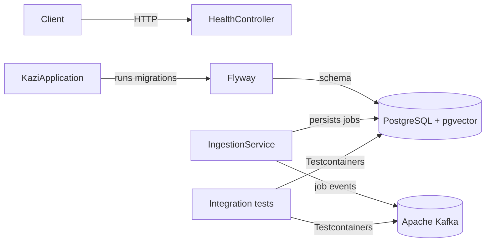
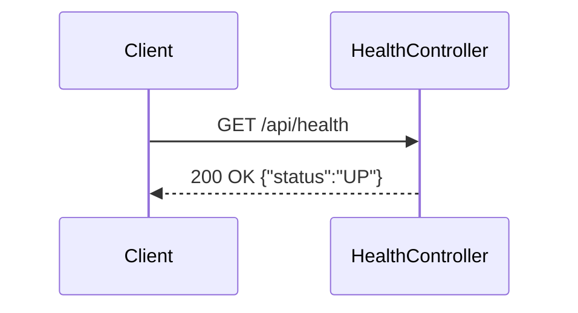

# Kazi

An AI job aggregator backend for collecting, cleaning, and searching software engineering jobs through REST and MCP.

## What this is
Kazi is intended to bring fragmented job listings into one canonical dataset. It is being built incrementally; the current release contains the application foundation, health endpoint, normalization, Adzuna, Greenhouse, Lever, Ashby, Workday, SmartRecruiters, Workable, Recruitee, Personio, and BambooHR source adapters, Kafka job events, REST job search and details, and MCP job tools.

## Architecture





## Tech stack
Java 25 · Spring Boot 4.1 · Spring AI 2.0 · Spring HTTP Interface · Spring Framework resilience · Spring Kafka · Apache Kafka · PostgreSQL 18 · pgvector · Flyway · Resilience4j circuit breaker · Testcontainers · Docker

## Getting started
```bash
docker compose up --build
curl http://localhost:8080/api/health
```

Run the tests with Docker running:
```bash
./mvnw test
```

For disposable development PostgreSQL and Kafka containers:
```bash
./mvnw spring-boot:test-run
```

Docker Compose enables six-hour ingestion after a ten-second startup delay and configures nine public companies by default: Vercel (Greenhouse), Palantir (Lever), Linear (Ashby), Workday, SmartRecruiters, Hugging Face (Workable), Helloprint (Recruitee), Karla (Personio), and Fly.io (BambooHR). Set `INGESTION_SCHEDULING_ENABLED=false` to disable polling or override any company's environment variables. Direct Maven runs remain opt-in; set `INGESTION_SCHEDULING_ENABLED=true` to enable them. `INGESTION_INITIAL_DELAY` controls the first run.

Adzuna reads `ADZUNA_APP_ID` and `ADZUNA_APP_KEY`, with optional `ADZUNA_COUNTRY` and `ADZUNA_CURRENCY` overrides; it stays inactive without credentials. `KAFKA_BOOTSTRAP_SERVERS` overrides the default `localhost:9092` broker address.

Greenhouse uses the public, read-only Job Board API and needs no API key. Configure each company's display name and board token; board 0 can be set directly in `.env` for Docker Compose:

```bash
GREENHOUSE_BOARDS_0_COMPANY=Vercel
GREENHOUSE_BOARDS_0_TOKEN=vercel
INGESTION_SCHEDULING_ENABLED=true
```

For additional boards, add `GREENHOUSE_BOARDS_1_COMPANY` and `GREENHOUSE_BOARDS_1_TOKEN` (incrementing the index) to the app's environment in a Compose override. The equivalent application YAML is:

```yaml
greenhouse:
  boards:
    - company: Vercel
      token: vercel
    - company: Acme
      token: acme
```

Each board is audited as `greenhouse:<token>`. Greenhouse's `updated_at` drives incremental fetches and is preserved in the raw payload; it is not treated as the original publication date. `GREENHOUSE_POLL_INTERVAL` defaults to `PT6H`.

Lever uses the public, read-only [Postings API](https://github.com/lever/postings-api) and needs no API key for published jobs. Configure company names and site identifiers with `LEVER_SITES_0_COMPANY` and `LEVER_SITES_0_SITE` in `.env`; add higher indexes through a Compose override for more companies. The YAML equivalent is:

```yaml
lever:
  sites:
    - company: Acme
      site: acme
    - company: Example
      site: example
```

Lever ingestion fetches every page, filters by `createdAt`, maps salary and remote locations, and stores the original apply URL. Each site is audited as `lever:<site>`. `LEVER_POLL_INTERVAL` defaults to `PT6H`.

Ashby uses the public [Job Posting API](https://developers.ashbyhq.com/docs/public-job-posting-api) and needs no API key. Configure companies and board names with `ASHBY_ORGANIZATIONS_0_COMPANY` and `ASHBY_ORGANIZATIONS_0_BOARD` in `.env`; add higher indexes through a Compose override for more organizations. The YAML equivalent is:

```yaml
ashby:
  organizations:
    - company: Linear
      board: linear
    - company: Ashby
      board: Ashby
```

Ashby ingestion requests compensation data, filters by `publishedAt`, maps employment and workplace types, prefers plain-text descriptions, and stores the original apply URL. Each board is audited as `ashby:<board>`. `ASHBY_POLL_INTERVAL` defaults to `PT6H`.

Workday reads the same unauthenticated JSON endpoints used by configured public `myworkdayjobs.com` career sites; no API key or HTML scraping is involved. Configure the company, site origin, tenant, and career-site identifier with `WORKDAY_SITES_0_COMPANY`, `WORKDAY_SITES_0_BASE_URL`, `WORKDAY_SITES_0_TENANT`, and `WORKDAY_SITES_0_SITE` in `.env`. Add higher indexes through a Compose override for more sites. The YAML equivalent is:

```yaml
workday:
  sites:
    - company: Workday
      base-url: https://workday.wd5.myworkdayjobs.com
      tenant: workday
      site: Workday
```

Workday fetches every 20-item page and each posting's public detail JSON, mapping its description, posting date, locations, remote status, employment type, and original URL. Each site is audited as `workday:<tenant>/<site>`. `WORKDAY_POLL_INTERVAL` defaults to `PT6H`. Only configure public career sites whose terms and robots rules permit this access.

SmartRecruiters uses the public postings endpoints behind hosted career sites and needs no API key for public listings. Configure a display name and the case-sensitive company identifier from `jobs.smartrecruiters.com/<identifier>`:

```yaml
smartrecruiters:
  companies:
    - company: SmartRecruiters
      identifier: smartrecruiters
```

Docker Compose accepts `SMARTRECRUITERS_COMPANIES_0_COMPANY` and `SMARTRECRUITERS_COMPANIES_0_IDENTIFIER`. The adapter pages through every listing, fetches public details for descriptions and application links, and audits each company as `smartrecruiters:<identifier>`. `SMARTRECRUITERS_POLL_INTERVAL` defaults to `PT6H`.

Workable uses the public careers-widget endpoint and needs no API key. Configure a display name and the account slug from `apply.workable.com/<account>`:

```yaml
workable:
  accounts:
    - company: Hugging Face
      account: huggingface
```

Docker Compose accepts `WORKABLE_ACCOUNTS_0_COMPANY` and `WORKABLE_ACCOUNTS_0_ACCOUNT`. One request returns every open role with its description, publication date, locations, remote status, and application link. Each account is audited as `workable:<account>`. `WORKABLE_POLL_INTERVAL` defaults to `PT6H`.

Recruitee uses the public Careers Site offers endpoint and needs no API key. Configure a display name and subdomain from `<site>.recruitee.com`:

```yaml
recruitee:
  companies:
    - company: Helloprint
      site: helloprint
```

Docker Compose accepts `RECRUITEE_COMPANIES_0_COMPANY` and `RECRUITEE_COMPANIES_0_SITE`. The adapter maps complete descriptions, salary ranges, publication times, employment types, remote status, and office locations. Each company is audited as `recruitee:<site>`. `RECRUITEE_POLL_INTERVAL` defaults to `PT6H`.

Personio reads the public XML feed behind `<site>.jobs.personio.de` career pages and needs no API key. Configure a display name and subdomain:

```yaml
personio:
  companies:
    - company: Karla
      site: gokarla-gmbh
```

Docker Compose accepts `PERSONIO_COMPANIES_0_COMPANY` and `PERSONIO_COMPANIES_0_SITE`. The secure XML parser maps descriptions, creation times, schedules, and primary and additional offices without external entity access. Each company is audited as `personio:<site>`. `PERSONIO_POLL_INTERVAL` defaults to `PT6H`.

BambooHR reads the public careers list and detail endpoints behind `<site>.bamboohr.com/careers` and needs no API key. Configure a display name and subdomain:

```yaml
bamboohr:
  companies:
    - company: Fly.io
      site: flyio
```

Docker Compose accepts `BAMBOOHR_COMPANIES_0_COMPANY` and `BAMBOOHR_COMPANIES_0_SITE`. The adapter maps detail descriptions, compensation, posting dates, locations, remote status, and original job links. Each company is audited as `bamboohr:<site>`. `BAMBOOHR_POLL_INTERVAL` defaults to `PT6H`.

## Career-site discovery
Discovery accepts either a direct ATS board URL or a company's public career page. A direct board is routed immediately; a career page is fetched once and its Greenhouse, Lever, Ashby, Workday, SmartRecruiters, Workable, Recruitee, Personio, and BambooHR links are routed to the same adapters. It does not crawl further pages or bypass authentication. Private and local addresses are rejected, redirects are disabled for generic pages, and at most 25 distinct boards are ingested per configured page.

```yaml
discovery:
  sites:
    - company: Acme
      url: https://www.acme.com/careers
    - company: Hugging Face
      url: https://apply.workable.com/huggingface
```

Docker Compose accepts `DISCOVERY_SITES_0_COMPANY` and `DISCOVERY_SITES_0_URL`. Add higher indexes through a Compose override for more pages. `DISCOVERY_POLL_INTERVAL` defaults to `PT6H`, and discovery uses the same global scheduling switch and audited full-snapshot ingestion as configured adapters. Only configure public pages whose terms and robots rules permit access.

## Job lifecycle
Greenhouse, Lever, Ashby, Workday, SmartRecruiters, Workable, Recruitee, Personio, and BambooHR runs fetch complete source snapshots. Exact normalized role matches can merge across different sources, while different requisition IDs from the same source stay separate even when their titles match. Every distinct source posting retains its own link even when several postings merge into one canonical job. A source link that disappears from a completed snapshot becomes inactive without deleting its provenance. The canonical job becomes inactive only when every source link is inactive, so overlapping listings remain searchable. A later sighting reactivates both the link and job. Failed fetches never deactivate jobs. Adzuna remains incremental and does not perform removal reconciliation.

## Job events
Ingestion publishes versioned JSON events after saving each canonical job:
- `job.events.indexed` for a new job.
- `job.events.merged` when a source matches an existing job.

Both use the job UUID as the Kafka key. The payload contains `schemaVersion`, `jobId`, `sourceRunId` for ingestion correlation, and `occurredAt`. When semantic search is enabled, the `kazi-semantic` consumer group reads both topics and creates or refreshes each job's embedding. The content hash skips unchanged jobs, including repeated merge events on later polls.

## Project structure
Code is packaged by feature. `health` contains the health controller. `ingestion` contains orchestration and scheduling, with focused subpackages for `source` contracts, `normalization`, and persistent `run` audits. The `adzuna`, `greenhouse`, `lever`, `ashby`, `workday`, `smartrecruiters`, `workable`, `recruitee`, `personio`, `bamboohr`, and `discovery` subpackages contain their declarative `@HttpExchange` clients, source adapters, response mapping, and schedulers. `RestClient` is used only as the underlying transport. `job` contains canonical jobs, source provenance, requisition-aware exact deduplication, merge rules, and Kafka event publishing. `search` contains keyword and semantic services, the job-event embedding consumer, pgvector persistence, paginated REST endpoints, and response DTOs. `mcp` contains MCP tool adapters over domain use cases.

## API
```bash
curl http://localhost:8080/api/health
curl "http://localhost:8080/api/jobs?q=java&location=Nairobi&employmentType=FULL_TIME&page=0&size=20"
curl http://localhost:8080/api/jobs/<job-uuid>
```

`GET /api/jobs` returns active jobs, newest first. All filters are optional: `q` matches title, company, or description case-insensitively; `location` matches a location substring; `employmentType` accepts `FULL_TIME`, `PART_TIME`, `CONTRACT`, or `INTERNSHIP`. `page` is zero-based, `size` defaults to 20 and is capped at 100. Responses include `content`, `page`, `size`, `totalElements`, and `totalPages`.

`GET /api/jobs/{id}` returns the complete job and a `sources` array containing each original source/application URL. A missing job returns a 404 ProblemDetail response.

## Semantic search
Semantic retrieval uses local Ollama `snowflake-arctic-embed:137m` embeddings (768 dimensions) and pgvector cosine distance with an HNSW index. Job text is capped at 6,000 characters, and a content hash prevents unchanged jobs from being embedded again. Inactive jobs are excluded. No job content leaves the machine.

Start the optional model service and pull the model once:

```bash
docker compose --profile semantic up -d ollama
docker compose exec ollama ollama pull snowflake-arctic-embed:137m
SEMANTIC_SEARCH_ENABLED=true docker compose --profile semantic up -d --build app
```

Then query `GET /api/jobs/search/semantic?q=distributed%20java%20backend&limit=20`. Results are closest first and capped at 50 for REST. When `SEMANTIC_SEARCH_ENABLED` is false, the endpoint returns a 503 ProblemDetail response instead of silently substituting keyword search.

## MCP
The server exposes streamable HTTP at `http://localhost:8080/mcp`. Its `search_active_jobs` tool accepts required `query` keywords plus optional `location`, `employmentType`, and `limit` arguments. Results are newest first and limited to 20. `semantic_search_jobs` accepts a required meaning-based `query` and optional `limit` and returns closest matches when semantic search is enabled. `get_job_details` accepts a required `jobId` UUID from the search results and returns full details with original source/application links.

MCP clients send `X-API-Key: <your-key>`. Health and public job-search endpoints remain public. Production uses two kinds of credential:

- The `KAZI_API_KEY` bootstrap credential is private to the administrator. It can use MCP and metrics and manage keys through the local-only admin endpoints.
- Individual keys have an owner, scopes, a 90-day default expiry, revocation state, and last-used timestamp. Only their SHA-256 hashes and non-secret prefixes are stored. Plaintext is returned once at creation or rotation. `jobs:read` permits MCP; `metrics:read` separately permits private metrics.

On the AWS host, manage keys through SSM from `/opt/kazi`:

```bash
./scripts/api-keys.sh create "Jane" "jane@example.com" 90
./scripts/api-keys.sh list
./scripts/api-keys.sh rotate <key-uuid> 90
./scripts/api-keys.sh revoke <key-uuid>
```

Rotation revokes the old key and returns a replacement once; update the client with that replacement. The Caddy proxy rejects admin endpoint requests from outside the host. A blank bootstrap key preserves unauthenticated local development, while production Compose requires a file-backed key.

Inspect the available tools and call them with the MCP Inspector:
```bash
npx --yes @modelcontextprotocol/inspector@2.13.0 --cli \
  --transport http --server-url http://localhost:8080/mcp \
  --method tools/list --format json

npx --yes @modelcontextprotocol/inspector@2.13.0 --cli \
  --transport http --server-url http://localhost:8080/mcp \
  --method tools/call --tool-name search_active_jobs \
  --tool-args-json '{"query":"java","limit":5}' --format json

npx --yes @modelcontextprotocol/inspector@2.13.0 --cli \
  --transport http --server-url http://localhost:8080/mcp \
  --method tools/call --tool-name get_job_details \
  --tool-args-json '{"jobId":"<job-uuid>"}' --format json
```

When authentication is enabled, add `--header "X-API-Key: $KAZI_API_KEY"` to each Inspector command.

## Observability
The app exports HTTP/JDBC metrics, traces, and application logs through OpenTelemetry. Export is disabled by default. Start the local Grafana LGTM backend and enable it with:

```bash
OTEL_EXPORT_ENABLED=true docker compose --profile observability up -d --build
```

Grafana is available at `http://localhost:3000` with the local-development login `admin` / `admin`. The `kazi` service appears in Prometheus, Tempo, and Loki. Change the Grafana credentials before exposing it beyond localhost. `OTEL_EXPORTER_OTLP_ENDPOINT` overrides the collector URL, `OTEL_SAMPLING_PROBABILITY` controls trace sampling, and `DEPLOYMENT_ENVIRONMENT` and `APP_VERSION` annotate telemetry. If local ports conflict, override `GRAFANA_PORT`, `OTEL_GRPC_PORT`, and `OTEL_HTTP_PORT`; the app continues to use the collector's internal Compose address.

## Production Compose
`docker-compose.prod.yml` mounts the database password and bootstrap admin key from uncommitted files under `secrets/`; they are not injected as container environment variables. The directory is excluded from Git and Docker build contexts. Production also refuses to start with a blank bootstrap key, enables restart policies, lowers trace sampling to 0.1, and removes host ports for PostgreSQL and Kafka.

```bash
install -d -m 700 secrets
openssl rand -hex 24 | tr -d '\n' > secrets/db_password
openssl rand -hex 24 | tr -d '\n' > secrets/kazi_api_key
chmod 644 secrets/*
docker compose -f docker-compose.yml -f docker-compose.prod.yml up -d --build
docker compose -f docker-compose.yml -f docker-compose.prod.yml ps
```

The app waits for healthy PostgreSQL and Kafka containers and has its own `/actuator/health` check. Back up the `postgres_data` volume. When reusing a volume, rotate the PostgreSQL role password separately; changing the secret file only initializes credentials on a fresh volume. The AWS Caddy configuration provides trusted HTTPS and blocks public access to key-management endpoints. For production telemetry, set `OTEL_EXPORT_ENABLED=true` and point `OTEL_EXPORTER_OTLP_ENDPOINT` at an authenticated collector; do not expose the local LGTM admin interface publicly.

## AWS deployment

The `infra/terraform` directory contains a low-cost, single-EC2 deployment with self-hosted PostgreSQL and Kafka, SSM administration, S3 backups, automatic HTTPS through an `sslip.io` hostname, and an AWS Budget alert. The detailed AWS runbook is maintained locally in `DEPLOYMENT.local.md` and is intentionally excluded from Git.

## Testing
The health integration test starts the application on a random port, runs Flyway against real PostgreSQL, and calls the endpoint over HTTP. Normalization and source mapping use small plain-JUnit tests with mocked HTTP responses. Focused tests prove Spring Framework retries and Resilience4j circuit breaking. Ingestion and job integration tests use real PostgreSQL to verify run audits, failure isolation, all source adapters, career-page discovery and routing, requisition-aware exact deduplication, merging, source provenance, multi-source deactivation, failed-fetch safety, and reactivation. Kafka integration tests use a real broker to verify both topics, JSON events, keys, source-run correlation, and event-driven embedding of new and merged jobs. Search integration tests exercise filtering, pagination, job details, source links, semantic pgvector ranking, unchanged-content skipping, inactive-job exclusion, and error responses through real HTTP requests to PostgreSQL. MCP tests validate tool arguments in plain JUnit and use a real MCP Java SDK client to list tools, call keyword and semantic search and job details, and verify error results without a live LLM. Security integration tests verify public endpoints, hashed key storage, scopes, admin authorization, valid/invalid/expired/revoked keys, and rotation. Telemetry export is disabled in tests; the local LGTM profile provides live three-signal verification.

## Status
- Built: application foundation, database migrations, health endpoint, source contract, normalization, Adzuna, multi-board Greenhouse, paginated multi-site Lever, multi-organization Ashby, paginated multi-site Workday, multi-company SmartRecruiters, multi-account Workable, multi-company Recruitee, multi-company Personio, and multi-company BambooHR adapters, career-site discovery and routing, opt-in scheduling, run audits, canonical job persistence, requisition-aware exact deduplication, full-snapshot job reconciliation, Kafka job event publishing, local Ollama embeddings and pgvector semantic search, REST keyword and semantic search and details, source/application links, MCP keyword and semantic search and job-detail tools, hashed scoped API keys with admin lifecycle management, OpenTelemetry export, development and production Compose configuration, low-cost single-EC2 Terraform configuration with HTTPS, and CI.
- Not built: Redis, frontend, user accounts, remote Terraform state, and CI/CD cloud deployment.
