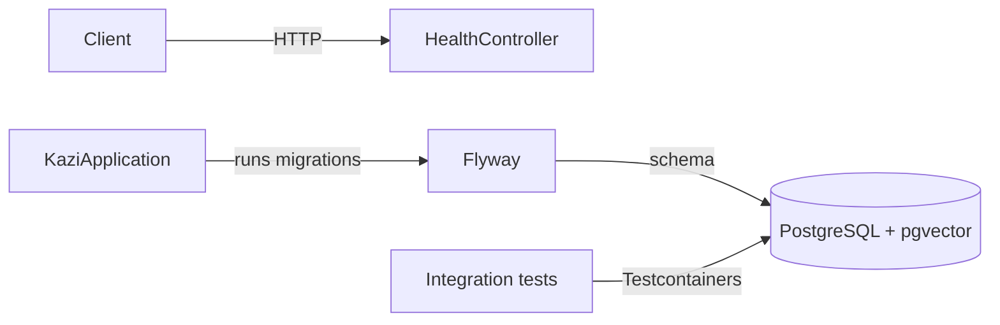
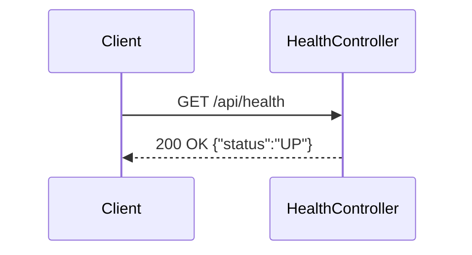

# Kazi

An AI job aggregator backend for collecting, cleaning, and searching software engineering jobs through REST and MCP.

## What this is
Kazi is intended to bring fragmented job listings into one canonical dataset. It is being built incrementally; the current release contains the application foundation, health endpoint, normalization, and Adzuna source adapter.

## Architecture





## Tech stack
Java 25 · Spring Boot 4.1 · Spring HTTP Interface · Spring Framework resilience · PostgreSQL 18 · pgvector · Flyway · Resilience4j circuit breaker · Testcontainers · Docker

## Getting started
```bash
docker compose up --build
curl http://localhost:8080/api/health
```

Run the tests with Docker running:
```bash
./mvnw test
```

For a disposable development database:
```bash
./mvnw spring-boot:test-run
```

Adzuna reads `ADZUNA_APP_ID` and `ADZUNA_APP_KEY`, with optional `ADZUNA_COUNTRY` and `ADZUNA_CURRENCY` overrides. Scheduling is disabled by default; set `INGESTION_SCHEDULING_ENABLED=true` to enable the six-hour poll interval. `INGESTION_INITIAL_DELAY` controls the first run.

## Project structure
Code is packaged by feature. `health` contains the health controller. `ingestion` contains orchestration and scheduling, with focused subpackages for `source` contracts, `normalization`, and persistent `run` audits. The `adzuna` subpackage contains its declarative `@HttpExchange` client, source adapter, and scheduler. `RestClient` is used only as the underlying transport. `job` contains canonical jobs, source provenance, deterministic deduplication, and merge rules. Future search and MCP code will live in separate feature packages.

## API
```bash
curl http://localhost:8080/api/health
```

## Architecture decisions
- [ADR-0001](docs/adr/0001-package-by-feature-monolith.md) — Package-by-feature monolith over microservices

## Testing
The health integration test starts the application on a random port, runs Flyway against real PostgreSQL, and calls the endpoint over HTTP. Normalization and Adzuna mapping use small plain-JUnit tests. Focused tests prove Spring Framework retries and Resilience4j circuit breaking. Ingestion and job integration tests use real PostgreSQL to verify run audits, failure isolation, deterministic deduplication, merging, and source provenance.

## Status
- Built: application foundation, database migration, health endpoint, source contract, normalization, Adzuna adapter, opt-in scheduling, run audits, canonical job persistence, deterministic deduplication, Docker Compose, and CI.
- Not built: other source adapters, fuzzy deduplication, Kafka, search, Redis, MCP, security hardening, and full observability.
