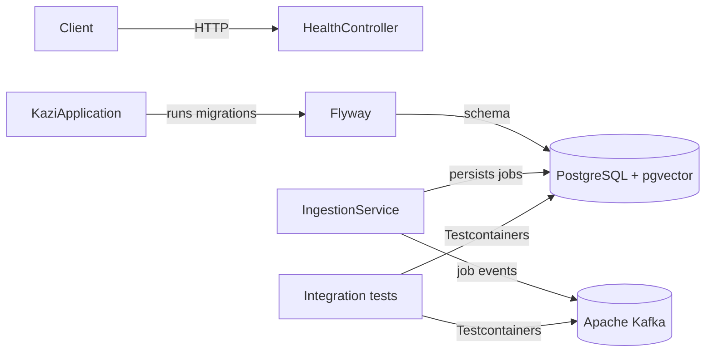
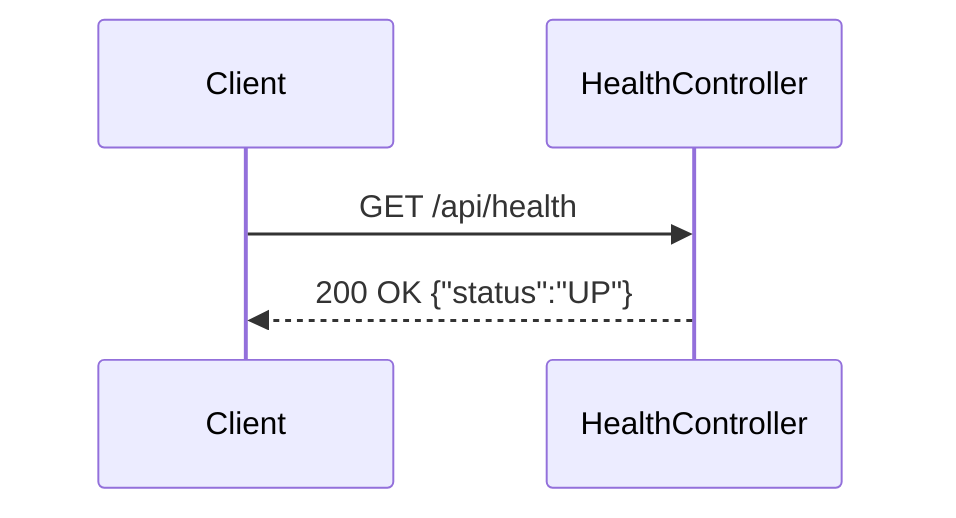

# Kazi

An AI job aggregator backend for collecting, cleaning, and searching software engineering jobs through REST and MCP.

## What this is
Kazi is intended to bring fragmented job listings into one canonical dataset. It is being built incrementally; the current release contains the application foundation, health endpoint, normalization, Adzuna, Greenhouse, Lever, Ashby, Workday, SmartRecruiters, Workable, Recruitee, and Personio source adapters, Kafka job events, REST job search and details, and MCP job tools.

## Architecture





## Tech stack
Java 25 · Spring Boot 4.1 · Spring AI 2.0 · Spring HTTP Interface · Spring Framework resilience · Spring Kafka · Apache Kafka · PostgreSQL 18 · pgvector · Flyway · Resilience4j circuit breaker · Testcontainers · Docker

## Getting started
```bash
docker compose up --build
curl http://localhost:8080/api/health
```

Run the tests with Docker running:
```bash
./mvnw test
```

For disposable development PostgreSQL and Kafka containers:
```bash
./mvnw spring-boot:test-run
```

Adzuna reads `ADZUNA_APP_ID` and `ADZUNA_APP_KEY`, with optional `ADZUNA_COUNTRY` and `ADZUNA_CURRENCY` overrides. Scheduling is disabled by default; set `INGESTION_SCHEDULING_ENABLED=true` to enable the six-hour poll interval. `INGESTION_INITIAL_DELAY` controls the first run. `KAFKA_BOOTSTRAP_SERVERS` overrides the default `localhost:9092` broker address.

Greenhouse uses the public, read-only Job Board API and needs no API key. Configure each company's display name and board token; board 0 can be set directly in `.env` for Docker Compose:

```bash
GREENHOUSE_BOARDS_0_COMPANY=Vercel
GREENHOUSE_BOARDS_0_TOKEN=vercel
INGESTION_SCHEDULING_ENABLED=true
```

For additional boards, add `GREENHOUSE_BOARDS_1_COMPANY` and `GREENHOUSE_BOARDS_1_TOKEN` (incrementing the index) to the app's environment in a Compose override. The equivalent application YAML is:

```yaml
greenhouse:
  boards:
    - company: Vercel
      token: vercel
    - company: Acme
      token: acme
```

Each board is audited as `greenhouse:<token>`. Greenhouse's `updated_at` drives incremental fetches and is preserved in the raw payload; it is not treated as the original publication date. `GREENHOUSE_POLL_INTERVAL` defaults to `PT6H`.

Lever uses the public, read-only [Postings API](https://github.com/lever/postings-api) and needs no API key for published jobs. Configure company names and site identifiers with `LEVER_SITES_0_COMPANY` and `LEVER_SITES_0_SITE` in `.env`; add higher indexes through a Compose override for more companies. The YAML equivalent is:

```yaml
lever:
  sites:
    - company: Acme
      site: acme
    - company: Example
      site: example
```

Lever ingestion fetches every page, filters by `createdAt`, maps salary and remote locations, and stores the original apply URL. Each site is audited as `lever:<site>`. `LEVER_POLL_INTERVAL` defaults to `PT6H`.

Ashby uses the public [Job Posting API](https://developers.ashbyhq.com/docs/public-job-posting-api) and needs no API key. Configure companies and board names with `ASHBY_ORGANIZATIONS_0_COMPANY` and `ASHBY_ORGANIZATIONS_0_BOARD` in `.env`; add higher indexes through a Compose override for more organizations. The YAML equivalent is:

```yaml
ashby:
  organizations:
    - company: Linear
      board: linear
    - company: Ashby
      board: Ashby
```

Ashby ingestion requests compensation data, filters by `publishedAt`, maps employment and workplace types, prefers plain-text descriptions, and stores the original apply URL. Each board is audited as `ashby:<board>`. `ASHBY_POLL_INTERVAL` defaults to `PT6H`.

Workday reads the same unauthenticated JSON endpoints used by configured public `myworkdayjobs.com` career sites; no API key or HTML scraping is involved. Configure the company, site origin, tenant, and career-site identifier with `WORKDAY_SITES_0_COMPANY`, `WORKDAY_SITES_0_BASE_URL`, `WORKDAY_SITES_0_TENANT`, and `WORKDAY_SITES_0_SITE` in `.env`. Add higher indexes through a Compose override for more sites. The YAML equivalent is:

```yaml
workday:
  sites:
    - company: Workday
      base-url: https://workday.wd5.myworkdayjobs.com
      tenant: workday
      site: Workday
```

Workday fetches every 20-item page and each posting's public detail JSON, mapping its description, posting date, locations, remote status, employment type, and original URL. Each site is audited as `workday:<tenant>/<site>`. `WORKDAY_POLL_INTERVAL` defaults to `PT6H`. Only configure public career sites whose terms and robots rules permit this access.

SmartRecruiters uses the public postings endpoints behind hosted career sites and needs no API key for public listings. Configure a display name and the case-sensitive company identifier from `jobs.smartrecruiters.com/<identifier>`:

```yaml
smartrecruiters:
  companies:
    - company: SmartRecruiters
      identifier: smartrecruiters
```

Docker Compose accepts `SMARTRECRUITERS_COMPANIES_0_COMPANY` and `SMARTRECRUITERS_COMPANIES_0_IDENTIFIER`. The adapter pages through every listing, fetches public details for descriptions and application links, and audits each company as `smartrecruiters:<identifier>`. `SMARTRECRUITERS_POLL_INTERVAL` defaults to `PT6H`.

Workable uses the public careers-widget endpoint and needs no API key. Configure a display name and the account slug from `apply.workable.com/<account>`:

```yaml
workable:
  accounts:
    - company: Hugging Face
      account: huggingface
```

Docker Compose accepts `WORKABLE_ACCOUNTS_0_COMPANY` and `WORKABLE_ACCOUNTS_0_ACCOUNT`. One request returns every open role with its description, publication date, locations, remote status, and application link. Each account is audited as `workable:<account>`. `WORKABLE_POLL_INTERVAL` defaults to `PT6H`.

Recruitee uses the public Careers Site offers endpoint and needs no API key. Configure a display name and subdomain from `<site>.recruitee.com`:

```yaml
recruitee:
  companies:
    - company: Helloprint
      site: helloprint
```

Docker Compose accepts `RECRUITEE_COMPANIES_0_COMPANY` and `RECRUITEE_COMPANIES_0_SITE`. The adapter maps complete descriptions, salary ranges, publication times, employment types, remote status, and office locations. Each company is audited as `recruitee:<site>`. `RECRUITEE_POLL_INTERVAL` defaults to `PT6H`.

Personio reads the public XML feed behind `<site>.jobs.personio.de` career pages and needs no API key. Configure a display name and subdomain:

```yaml
personio:
  companies:
    - company: Karla
      site: gokarla-gmbh
```

Docker Compose accepts `PERSONIO_COMPANIES_0_COMPANY` and `PERSONIO_COMPANIES_0_SITE`. The secure XML parser maps descriptions, creation times, schedules, and primary and additional offices without external entity access. Each company is audited as `personio:<site>`. `PERSONIO_POLL_INTERVAL` defaults to `PT6H`.

## Job lifecycle
Greenhouse, Lever, Ashby, Workday, SmartRecruiters, Workable, Recruitee, and Personio runs fetch complete source snapshots. Every distinct source posting retains its own link even when several postings merge into one canonical job. A source link that disappears from a completed snapshot becomes inactive without deleting its provenance. The canonical job becomes inactive only when every source link is inactive, so overlapping listings remain searchable. A later sighting reactivates both the link and job. Failed fetches never deactivate jobs. Adzuna remains incremental and does not perform removal reconciliation.

## Job events
Ingestion publishes versioned JSON events after saving each canonical job:
- `job.events.indexed` for a new job.
- `job.events.merged` when a source matches an existing job.

Both use the job UUID as the Kafka key. The payload contains `schemaVersion`, `jobId`, `sourceRunId` for ingestion correlation, and `occurredAt`.

## Project structure
Code is packaged by feature. `health` contains the health controller. `ingestion` contains orchestration and scheduling, with focused subpackages for `source` contracts, `normalization`, and persistent `run` audits. The `adzuna`, `greenhouse`, `lever`, `ashby`, `workday`, `smartrecruiters`, `workable`, `recruitee`, and `personio` subpackages contain their declarative `@HttpExchange` clients, source adapters, response mapping, and schedulers. `RestClient` is used only as the underlying transport. `job` contains canonical jobs, source provenance, deterministic deduplication, merge rules, and Kafka event publishing. `search` contains the shared job-search service, paginated REST endpoint, and response DTOs. `mcp` contains MCP tool adapters over domain use cases.

## API
```bash
curl http://localhost:8080/api/health
curl "http://localhost:8080/api/jobs?q=java&location=Nairobi&employmentType=FULL_TIME&page=0&size=20"
curl http://localhost:8080/api/jobs/<job-uuid>
```

`GET /api/jobs` returns active jobs, newest first. All filters are optional: `q` matches title, company, or description case-insensitively; `location` matches a location substring; `employmentType` accepts `FULL_TIME`, `PART_TIME`, `CONTRACT`, or `INTERNSHIP`. `page` is zero-based, `size` defaults to 20 and is capped at 100. Responses include `content`, `page`, `size`, `totalElements`, and `totalPages`.

`GET /api/jobs/{id}` returns the complete job and a `sources` array containing each original source/application URL. A missing job returns a 404 ProblemDetail response.

## MCP
The server exposes streamable HTTP at `http://localhost:8080/mcp`. Its `search_active_jobs` tool accepts required `query` keywords plus optional `location`, `employmentType`, and `limit` arguments. Results are newest first and limited to 20. `get_job_details` accepts a required `jobId` UUID from the search results and returns full details with original source/application links. The endpoint is unauthenticated and intended for local development only.

Inspect the available tools and call them with the MCP Inspector:
```bash
npx --yes @modelcontextprotocol/inspector@2.13.0 --cli \
  --transport http --server-url http://localhost:8080/mcp \
  --method tools/list --format json

npx --yes @modelcontextprotocol/inspector@2.13.0 --cli \
  --transport http --server-url http://localhost:8080/mcp \
  --method tools/call --tool-name search_active_jobs \
  --tool-args-json '{"query":"java","limit":5}' --format json

npx --yes @modelcontextprotocol/inspector@2.13.0 --cli \
  --transport http --server-url http://localhost:8080/mcp \
  --method tools/call --tool-name get_job_details \
  --tool-args-json '{"jobId":"<job-uuid>"}' --format json
```

## Architecture decisions
- [ADR-0001](docs/adr/0001-package-by-feature-monolith.md) — Package-by-feature monolith over microservices

## Testing
The health integration test starts the application on a random port, runs Flyway against real PostgreSQL, and calls the endpoint over HTTP. Normalization and source mapping use small plain-JUnit tests with mocked HTTP responses. Focused tests prove Spring Framework retries and Resilience4j circuit breaking. Ingestion and job integration tests use real PostgreSQL to verify run audits, failure isolation, multi-board Greenhouse, multi-site Lever, multi-organization Ashby, paginated multi-site Workday, multi-company SmartRecruiters, multi-account Workable, and multi-company Recruitee, and multi-company Personio ingestion, deterministic deduplication, merging, source provenance, multi-source deactivation, failed-fetch safety, and reactivation. Kafka integration tests use a real broker to verify both topics, JSON events, keys, and source-run correlation. Search integration tests exercise filtering, pagination, job details, source links, and 404 responses through real HTTP requests to PostgreSQL. MCP tests validate tool arguments in plain JUnit and use a real MCP Java SDK client to list tools, call search and job details, and verify error results without a live LLM.

## Status
- Built: application foundation, database migrations, health endpoint, source contract, normalization, Adzuna, multi-board Greenhouse, paginated multi-site Lever, multi-organization Ashby, paginated multi-site Workday, multi-company SmartRecruiters, multi-account Workable, and multi-company Recruitee, and multi-company Personio adapters, opt-in scheduling, run audits, canonical job persistence, deterministic deduplication, full-snapshot job reconciliation, Kafka job event publishing, REST job search and details, source/application links, MCP job-search and job-detail tools, Docker Compose, and CI.
- Not built: additional source adapters, fuzzy deduplication, event consumers, fuzzy and semantic search, Redis, MCP authentication, security hardening, and full observability.
