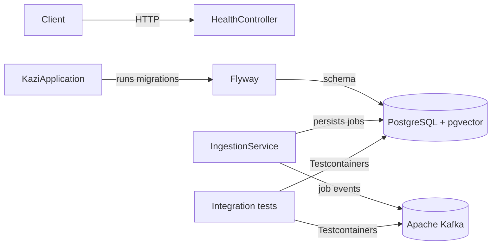
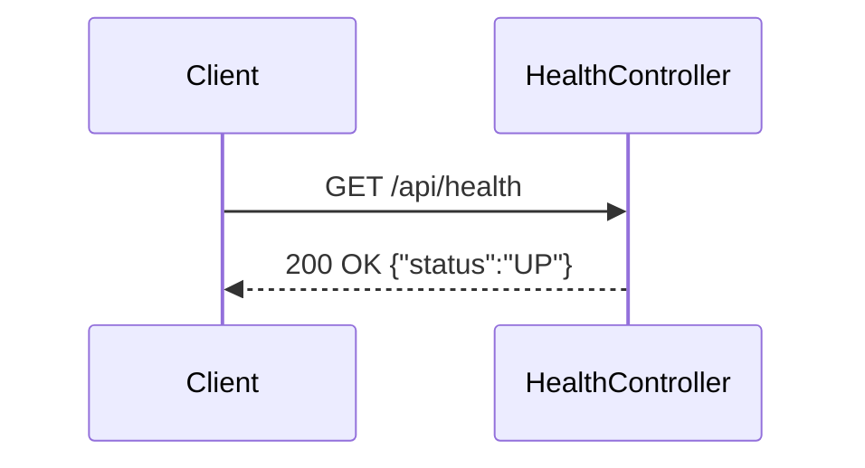

# Kazi

An AI job aggregator backend for collecting, cleaning, and searching software engineering jobs through REST and MCP.

## What this is
Kazi is intended to bring fragmented job listings into one canonical dataset. It is being built incrementally; the current release contains the application foundation, health endpoint, normalization, Adzuna, Greenhouse, and Lever source adapters, Kafka job events, REST job search and details, and MCP job tools.

## Architecture





## Tech stack
Java 25 · Spring Boot 4.1 · Spring AI 2.0 · Spring HTTP Interface · Spring Framework resilience · Spring Kafka · Apache Kafka · PostgreSQL 18 · pgvector · Flyway · Resilience4j circuit breaker · Testcontainers · Docker

## Getting started
```bash
docker compose up --build
curl http://localhost:8080/api/health
```

Run the tests with Docker running:
```bash
./mvnw test
```

For disposable development PostgreSQL and Kafka containers:
```bash
./mvnw spring-boot:test-run
```

Adzuna reads `ADZUNA_APP_ID` and `ADZUNA_APP_KEY`, with optional `ADZUNA_COUNTRY` and `ADZUNA_CURRENCY` overrides. Scheduling is disabled by default; set `INGESTION_SCHEDULING_ENABLED=true` to enable the six-hour poll interval. `INGESTION_INITIAL_DELAY` controls the first run. `KAFKA_BOOTSTRAP_SERVERS` overrides the default `localhost:9092` broker address.

Greenhouse uses the public, read-only Job Board API and needs no API key. Configure each company's display name and board token; board 0 can be set directly in `.env` for Docker Compose:

```bash
GREENHOUSE_BOARDS_0_COMPANY=Vercel
GREENHOUSE_BOARDS_0_TOKEN=vercel
INGESTION_SCHEDULING_ENABLED=true
```

For additional boards, add `GREENHOUSE_BOARDS_1_COMPANY` and `GREENHOUSE_BOARDS_1_TOKEN` (incrementing the index) to the app's environment in a Compose override. The equivalent application YAML is:

```yaml
greenhouse:
  boards:
    - company: Vercel
      token: vercel
    - company: Acme
      token: acme
```

Each board is audited as `greenhouse:<token>`. Greenhouse's `updated_at` drives incremental fetches and is preserved in the raw payload; it is not treated as the original publication date. `GREENHOUSE_POLL_INTERVAL` defaults to `PT6H`.

Lever uses the public, read-only [Postings API](https://github.com/lever/postings-api) and needs no API key for published jobs. Configure company names and site identifiers with `LEVER_SITES_0_COMPANY` and `LEVER_SITES_0_SITE` in `.env`; add higher indexes through a Compose override for more companies. The YAML equivalent is:

```yaml
lever:
  sites:
    - company: Acme
      site: acme
    - company: Example
      site: example
```

Lever ingestion fetches every page, filters by `createdAt`, maps salary and remote locations, and stores the original apply URL. Each site is audited as `lever:<site>`. `LEVER_POLL_INTERVAL` defaults to `PT6H`.

## Job events
Ingestion publishes versioned JSON events after saving each canonical job:
- `job.events.indexed` for a new job.
- `job.events.merged` when a source matches an existing job.

Both use the job UUID as the Kafka key. The payload contains `schemaVersion`, `jobId`, `sourceRunId` for ingestion correlation, and `occurredAt`.

## Project structure
Code is packaged by feature. `health` contains the health controller. `ingestion` contains orchestration and scheduling, with focused subpackages for `source` contracts, `normalization`, and persistent `run` audits. The `adzuna`, `greenhouse`, and `lever` subpackages contain their declarative `@HttpExchange` clients, source adapters, response mapping, and schedulers. `RestClient` is used only as the underlying transport. `job` contains canonical jobs, source provenance, deterministic deduplication, merge rules, and Kafka event publishing. `search` contains the shared job-search service, paginated REST endpoint, and response DTOs. `mcp` contains MCP tool adapters over domain use cases.

## API
```bash
curl http://localhost:8080/api/health
curl "http://localhost:8080/api/jobs?q=java&location=Nairobi&employmentType=FULL_TIME&page=0&size=20"
curl http://localhost:8080/api/jobs/<job-uuid>
```

`GET /api/jobs` returns active jobs, newest first. All filters are optional: `q` matches title, company, or description case-insensitively; `location` matches a location substring; `employmentType` accepts `FULL_TIME`, `PART_TIME`, `CONTRACT`, or `INTERNSHIP`. `page` is zero-based, `size` defaults to 20 and is capped at 100. Responses include `content`, `page`, `size`, `totalElements`, and `totalPages`.

`GET /api/jobs/{id}` returns the complete job and a `sources` array containing each original source/application URL. A missing job returns a 404 ProblemDetail response.

## MCP
The server exposes streamable HTTP at `http://localhost:8080/mcp`. Its `search_active_jobs` tool accepts required `query` keywords plus optional `location`, `employmentType`, and `limit` arguments. Results are newest first and limited to 20. `get_job_details` accepts a required `jobId` UUID from the search results and returns full details with original source/application links. The endpoint is unauthenticated and intended for local development only.

Inspect the available tools and call them with the MCP Inspector:
```bash
npx --yes @modelcontextprotocol/inspector@2.13.0 --cli \
  --transport http --server-url http://localhost:8080/mcp \
  --method tools/list --format json

npx --yes @modelcontextprotocol/inspector@2.13.0 --cli \
  --transport http --server-url http://localhost:8080/mcp \
  --method tools/call --tool-name search_active_jobs \
  --tool-args-json '{"query":"java","limit":5}' --format json

npx --yes @modelcontextprotocol/inspector@2.13.0 --cli \
  --transport http --server-url http://localhost:8080/mcp \
  --method tools/call --tool-name get_job_details \
  --tool-args-json '{"jobId":"<job-uuid>"}' --format json
```

## Architecture decisions
- [ADR-0001](docs/adr/0001-package-by-feature-monolith.md) — Package-by-feature monolith over microservices

## Testing
The health integration test starts the application on a random port, runs Flyway against real PostgreSQL, and calls the endpoint over HTTP. Normalization and source mapping use small plain-JUnit tests with mocked HTTP responses. Focused tests prove Spring Framework retries and Resilience4j circuit breaking. Ingestion and job integration tests use real PostgreSQL to verify run audits, failure isolation, multi-board Greenhouse and multi-site Lever ingestion, deterministic deduplication, merging, and source provenance. Kafka integration tests use a real broker to verify both topics, JSON events, keys, and source-run correlation. Search integration tests exercise filtering, pagination, job details, source links, and 404 responses through real HTTP requests to PostgreSQL. MCP tests validate tool arguments in plain JUnit and use a real MCP Java SDK client to list tools, call search and job details, and verify error results without a live LLM.

## Status
- Built: application foundation, database migration, health endpoint, source contract, normalization, Adzuna, multi-board Greenhouse, and paginated multi-site Lever adapters, opt-in scheduling, run audits, canonical job persistence, deterministic deduplication, Kafka job event publishing, REST job search and details, source/application links, MCP job-search and job-detail tools, Docker Compose, and CI.
- Not built: additional source adapters, fuzzy deduplication, event consumers, fuzzy and semantic search, Redis, MCP authentication, security hardening, and full observability.
